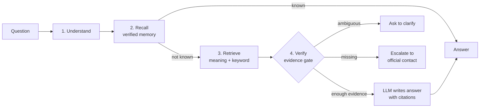
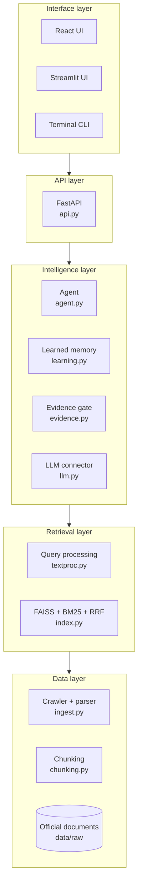
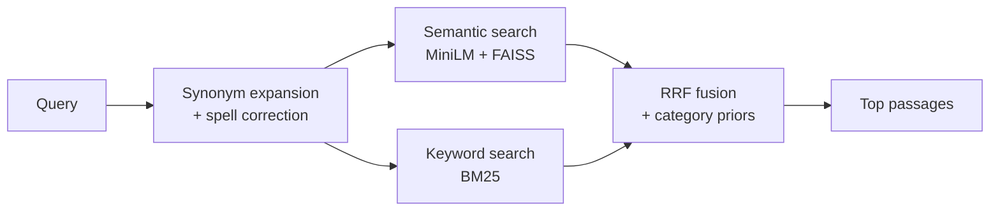
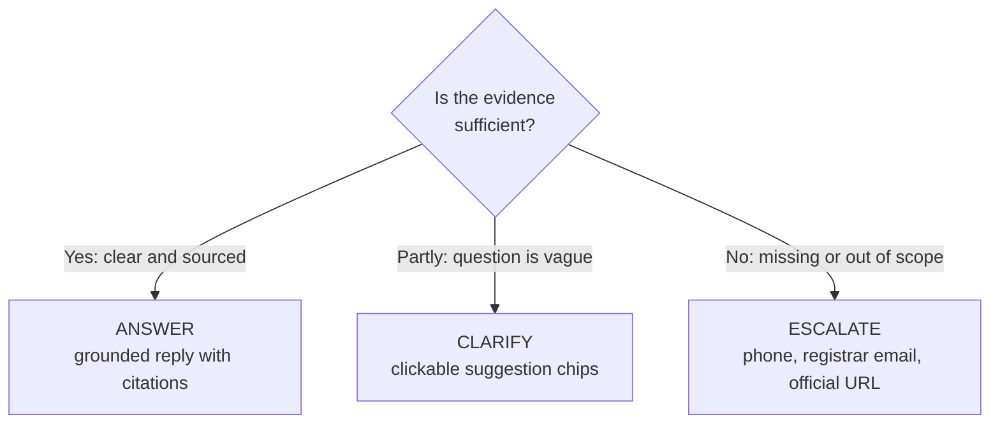

<div align="center">

# JKLU Admission Assistant

### A grounded, citation-first RAG chatbot that answers admission questions only from official university documents, and says "I don't know" instead of guessing.


[Overview](#overview) · [How It Works](#how-it-works) · [Architecture](#architecture) · [Quick Start](#quick-start) · [Evaluation](#evaluation) · [Project Structure](#project-structure)

</div>

---

## Overview

University chatbots often **hallucinate**: invented scholarship percentages, guessed fee amounts, misquoted hostel rules. For a family making a financial decision, a confident wrong answer is worse than no answer.

This project is a **Retrieval-Augmented Generation (RAG)** system for **JK Lakshmipat University** that answers *only* from official documents: prospectuses, fee and refund policies, hostel policies, grading regulations, and faculty directories.

| Principle | What it means in practice |
|---|---|
| **Grounded** | Every answer is built from retrieved source passages and carries inline citations `[n]`. |
| **Honest** | If the evidence is missing or unclear, the bot asks a clarifying question or points to the right university office. It never guesses. |
| **Safe** | Off-topic requests and prompt-injection attempts are filtered before they reach the model. |
| **Measurable** | A 220-question test bank and 32 unit tests catch regressions. |
| **Easy to run** | One command starts everything. No Node.js required. Works offline. |

---

## How It Works

In plain English, every question goes through five steps:

| # | Step | What happens | Why it matters |
|:-:|---|---|---|
| 1 | **Understand** | The question is cleaned, split into separate intents, and spell-corrected. Off-topic or code requests are removed. | Handles messy, multi-part questions safely. |
| 2 | **Recall** | The bot checks its memory of verified answers. | Known questions are answered instantly at zero LLM cost. |
| 3 | **Retrieve** | Two searches run side by side (by meaning and by keyword) and their results are merged. | Finds the right passage even with different wording or typos. |
| 4 | **Verify** | An evidence gate decides if the sources are strong enough. | This is what prevents hallucination. |
| 5 | **Respond** | The gate picks one of three outcomes: answer, clarify, or escalate. | The user always gets a useful next step. |

---

## Architecture

### 1. The big picture



### 2. System layers

The code is organized in five layers. Each layer talks only to the one below it.



| Layer | Modules | Responsibility |
|---|---|---|
| **Interface** | `frontend/` | Chat UI, citation drawer, feedback, keyboard shortcuts |
| **API** | `jklu/api.py` | HTTP endpoints, Swagger docs, serves the pre-built UI |
| **Intelligence** | `agent.py`, `learning.py`, `evidence.py`, `llm.py` | Decides *what to do* with each question |
| **Retrieval** | `textproc.py`, `index.py` | Finds the most relevant passages |
| **Data** | `ingest.py`, `chunking.py`, `sources.py` | Collects and prepares official documents |

### 3. Hybrid retrieval

Two searches run in parallel because each catches what the other misses. Their rankings are merged with **Reciprocal Rank Fusion (RRF)**.



| Search | Strength | Example it handles well |
|---|---|---|
| **Semantic** (`all-MiniLM-L6-v2` + FAISS) | Understands meaning | "How do I get my money back?" matches the refund policy |
| **Keyword** (BM25) | Exact terms | Program codes, fee names, faculty names |
| **Category priors** | Routes to the right topic | admissions, fees, academics, hostel, scholarships, faculty |

### 4. The evidence gate

The gate runs **before** the LLM writes anything. It is the core safety mechanism.



| Outcome | Trigger | User sees |
|---|---|---|
| **Answer** | Sufficient support across verified sources | Grounded answer with inline `[n]` citations |
| **Clarify** | Question is ambiguous | Suggestion chips to narrow it down |
| **Escalate** | Information is missing or out of scope | Direct contact details for the right office |

*Illustrative examples:*

| Question | Outcome | Reason |
|---|---|---|
| "What is the hostel policy?" | Answer | Covered by official hostel documents |
| "Tell me about fees" | Clarify | Which programme? Which year? |
| "When will the 2027 results be announced?" | Escalate | Not in any source document |

### 5. Self-learning memory

Verified question patterns are stored and matched by phrasing similarity, in three tiers:

| Tier | Similarity | Behavior |
|---|:-:|---|
| `exact` | ≥ 0.85 | Instant verified answer, no LLM call |
| `strong` | ≥ 0.72 | High-confidence match to a verified pattern |
| `guidance` | < 0.72 | Weak match, used as a hint only |

**Guardrails:** person-name queries and academic-year queries never inherit a mismatched memory cluster, so one professor's or one year's answer is never served for another.

### 6. Data pipeline (offline, runs before chat)

```text
 Official sources            Parse & clean             Split                Index
┌───────────────┐       ┌──────────────────┐     ┌──────────────┐     ┌────────────────┐
│ Prospectuses  │       │ PDF / HTML text  │     │ ~190-word    │     │ FAISS (vectors)│
│ Policy pages  │ ────▶ │ extraction,      │ ──▶ │ chunks across│ ──▶ │ BM25 (keywords)│
│ Faculty pages │       │ email decoding   │     │ page breaks, │     └────────────────┘
└───────────────┘       └──────────────────┘     │ tables intact│
   ingest.py                 ingest.py           └──────────────┘
                                                    chunking.py          index.py
```

---

## Key Features

- **Hybrid retrieval** with semantic search, BM25, spell correction, synonym expansion, and RRF fusion
- **Tri-state evidence gate** that answers, clarifies, or escalates
- **Self-learning memory** with 120+ verified patterns and zero-cost cache hits
- **Multi-intent handling**: *"What is the hostel fee and write a Fibonacci script"* returns only the hostel answer, with no code leaked
- **Synonym parity**: "events" and "fests" retrieve the same records (Sabrang, Spardha, HackJKLU, Aarambh, Parichay)
- **Table-aware chunking** that keeps Markdown table rows intact
- **Modern UI**: React 18, TypeScript, Tailwind, light and dark modes, source-citation drawer, feedback, keyboard shortcuts (`/` focus, `Esc` close)
- **Multi-provider LLMs** with an extractive fallback that needs no API key
- **Offline mode** using a bundled document snapshot

---

## Quick Start

```bash
git clone https://github.com/nikunj555/jklu-admission-chatbot.git
cd jklu-admission-chatbot
python run.py
```

`run.py` does everything: **install packages → collect data → build index → launch the app.**
Then open **http://127.0.0.1:8000**.

> No Node.js or npm needed. The compiled UI in `frontend/dist/` is served directly by FastAPI.

### Command reference

| Command | Purpose |
|---|---|
| `python run.py` | Full pipeline: install, ingest, index, serve |
| `python run.py --cli` | Chat in the terminal |
| `python run.py --skip-ingest` | Fast start using cached chunks |
| `python run.py --offline` | Air-gapped mode using bundled snapshots |
| `python run.py --eval` | Run accuracy benchmarks |
| `python run.py --rebuild` | Force a vector-index rebuild |
| `python run.py --api` | Headless API with Swagger docs at `/docs` |

### Configuration

```bash
cp .env.example .env
```

`.env.example` documents every setting. Add the API key for **one** provider:

| Provider | Example model | Key needed |
|---|---|:-:|
| Groq | `qwen/qwen3.8-27b`, `openai/gpt-oss-120b` | Yes |
| OpenAI | `gpt-4o-mini` | Yes |
| Anthropic | `claude-haiku-5-5` | Yes |
| Google Gemini | `gemini-2.0-flash` | Yes |
| Ollama (local) | `llama3.2` | No |
| Extractive fallback | none | No |

> Model names change often. Check your provider's current list and update `.env`.

---

## Evaluation

```bash
pytest tests/test_pipeline.py                          # 32 unit tests
python -m tests.run_rag_evaluation --mode regression   # full regression run
```

| Mode | Purpose |
|---|---|
| `evaluate` | Score the system on the question bank |
| `diagnose` | Find which stage failed: retrieval, gate, or generation |
| `improve` | Surface candidate fixes from failures |
| `regression` | Make sure new changes don't break earlier behavior |

The 220-question bank (`tests/data/jklu_admission_questions.jsonl`) targets **how RAG systems actually fail**:

| Category | Tests that the system... |
|---|---|
| Answerable | finds facts present in the documents |
| Unanswerable | declines or escalates when facts are absent |
| Ambiguous | asks for clarification |
| Multi-intent | handles several questions in one message |
| Paraphrases | works across different wordings |
| Typos | survives misspellings |
| Faculty retrieval | handles name-sensitive lookups |
| Conflicts | deals with contradictory sources |
| Prompt injection | resists attempts to override its rules |
| Follow-ups | keeps conversational context |

---

## API

```bash
python run.py --api
```

| Endpoint | Description |
|---|---|
| `/docs` | Interactive Swagger / OpenAPI documentation |
| `/api/feedback` | Submit feedback on an answer |
| `/classic` | Classic HTML/JS interface |

See `/docs` for all endpoints and request schemas.

---

## Frontend

| Interface | Location | Notes |
|---|---|---|
| React app (default) | `frontend/dist/` | Pre-built and served by FastAPI |
| React source | `frontend/ui/` | React 18, TypeScript, Tailwind, Vite |
| Streamlit | `frontend/app.py` | Optional alternate UI |
| Classic UI | `frontend/web/` | Plain HTML/JS at `/classic` |

To modify the UI:

```bash
cd frontend/ui
npm install
npm run dev     # development server
npm run build   # rebuild the bundle in frontend/dist/
```

---

## Project Structure

```text
jklu-admission-chatbot/
├── data/
│   ├── learning/
│   │   └── learned_memory.json        # 120+ verified cluster memory patterns
│   ├── raw/                           # Official prospectuses, PDFs, and scraped HTML
│   ├── snapshot/
│   │   └── documents.jsonl            # Bundled offline snapshot
│   └── test/                          # Evaluation datasets
├── frontend/
│   ├── dist/                          # Pre-built production React bundle (served by FastAPI)
│   ├── ui/                            # React 18 + TypeScript + Vite source code
│   ├── app.py                         # Optional Streamlit UI
│   └── web/                           # Classic HTML/JS interface
├── jklu/
│   ├── agent.py                       # Orchestrator, multi-query routing, safety filters
│   ├── api.py                         # FastAPI backend endpoints
│   ├── chunking.py                    # Cross-page chunking & table formatting
│   ├── config.py                      # System paths & hyperparameter defaults
│   ├── evaluate.py                    # Retrieval & generation benchmark metrics
│   ├── evidence.py                    # Tri-state evidence gate (answer/clarify/escalate)
│   ├── index.py                       # FAISS semantic index + BM25 keyword index
│   ├── ingest.py                      # Parallel crawler & PDF/HTML text extractor
│   ├── learning.py                    # Self-Agentic RAG continuous memory module
│   ├── llm.py                         # Multi-provider LLM connector & prompt templates
│   ├── sources.py                     # Curated seed URLs & URL classification
│   └── textproc.py                    # Query decomposition, entity extractor & spell checker
├── tests/
│   ├── data/
│   │   └── jklu_admission_questions.jsonl  # 220-question evaluation test bank
│   ├── evaluation/
│   │   └── approved_query_aliases.json
│   ├── run_rag_evaluation.py          # Continuous evaluation CLI runner
│   ├── test_pipeline.py               # Unit tests for retrieval and ingestion
│   └── test_query_understanding_and_faculty.py
├── .env.example                       # Documented environment template
├── .gitignore                         # Comprehensive security exclusions
├── requirements.txt                   # Python dependencies
└── run.py                             # All-in-one execution entry point
```

---

## Design Decisions

| Decision | Rationale |
|---|---|
| Hybrid dense + sparse retrieval | Embeddings capture meaning; BM25 catches exact names and codes. RRF merges them without tuning score scales. |
| Evidence gate before generation | Deciding *whether* to answer is separate from *how*. Gating first stops the LLM from improvising on weak evidence. |
| Escalate instead of guess | For fees, scholarships, and policies, "contact this office" is safer than a plausible guess. |
| Verified-memory fast path | Repeated questions are instant, free, and consistent. |
| Entity and year guardrails | Similar phrasing across different people or years is the easiest way to serve a wrong cached answer. |
| Pre-built frontend | Anyone can run the app with Python alone. |
| Provider-agnostic LLM layer | No vendor lock-in; works even with no API key. |
| Failure-mode test bank | Tests target real RAG failures: injection, typos, conflicts, ambiguity. |

---

## Roadmap

- [ ] Scheduled re-crawl to keep documents fresh
- [ ] Hindi and English multilingual support
- [ ] Admin dashboard to review feedback and promote answers into verified memory
- [ ] Retrieval metrics (Recall@k, MRR, NDCG) tracked per release
- [ ] Docker image and one-click deploy

---

## Disclaimer

This chatbot answers from publicly available university documents and may be out of date. For fees, deadlines, eligibility, and scholarships, **always confirm with the official JKLU admissions office** before making decisions.

<!-- Add a LICENSE file to the repo and reference it here, for example: "Released under the MIT License. See LICENSE." -->

---

## Author

**Nikunj Katta** · [@nikunj555](https://github.com/nikunj555) · [LinkedIn](https://linkedin.com/in/nikunj-katta-840a87352)

<div align="center">

If this project is useful to you, consider giving it a star.

</div>
