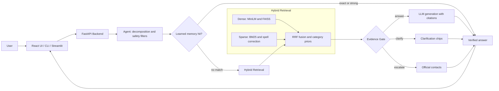
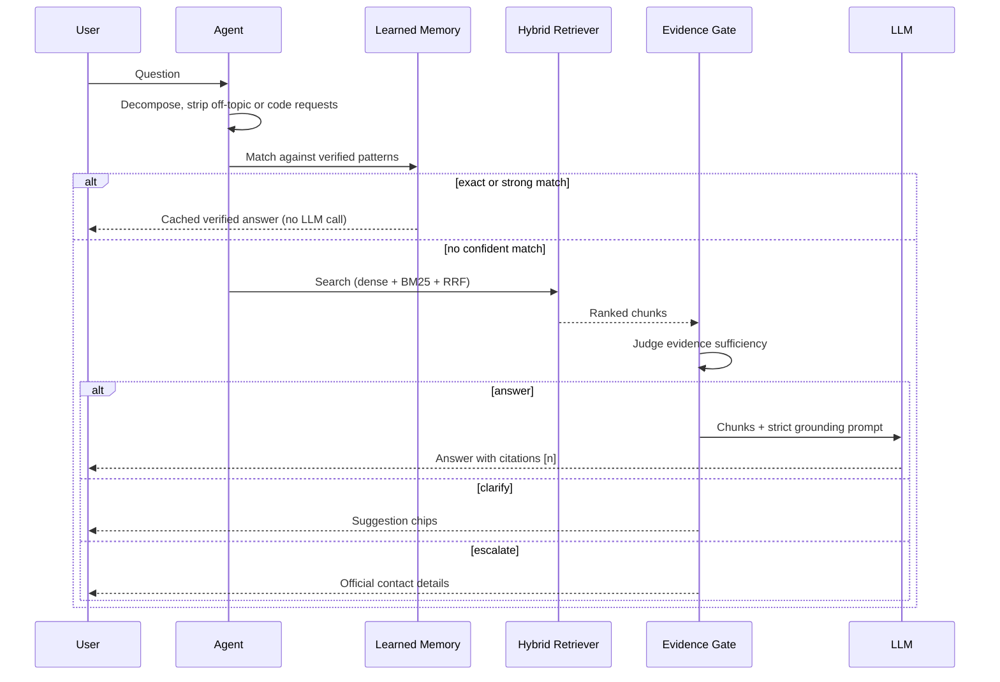

<div align="center">

# 🎓 JKLU Autonomous University Admission RAG Chatbot

**A grounded, citation-first Retrieval-Augmented Generation system that answers admission questions strictly from official university documents, and refuses to guess when the evidence isn't there.**


[Quick Start](#-quick-start) · [Architecture](#-architecture) · [Features](#-key-features) · [Evaluation](#-evaluation--testing) · [API](#-api) · [Project Structure](#-project-structure)

</div>

---

## 📖 Table of Contents

- [The Problem](#-the-problem)
- [The Solution](#-the-solution)
- [Key Features](#-key-features)
- [Architecture](#-architecture)
- [Quick Start](#-quick-start)
- [CLI Reference](#-cli-reference)
- [Configuration](#-configuration)
- [Evaluation & Testing](#-evaluation--testing)
- [API](#-api)
- [Frontend](#-frontend)
- [Project Structure](#-project-structure)
- [Design Decisions](#-design-decisions)
- [Roadmap](#-roadmap)
- [Disclaimer](#-disclaimer)
- [Author](#-author)

---

## ❗ The Problem

Generic university chatbots tend to **hallucinate**. They invent scholarship percentages, guess fee amounts, misquote hostel rules, and state admission criteria with total confidence. For a student or parent making a financial decision, a confident wrong answer is worse than no answer.

## ✅ The Solution

This project is an **autonomous Retrieval-Augmented Generation (RAG) system** built for **JK Lakshmipat University (JKLU)**. It answers prospective and enrolled students' questions using only official university material:

- Prospectuses and admission brochures
- Fee and refund policies
- Hostel and campus-life policies
- Grading and academic regulations
- Faculty directories

> **Zero-guess policy.** If the evidence is missing or ambiguous, the bot does not improvise. It either asks a clarifying question or escalates to the verified university contact (phone, registrar email, official URL).

---

## ✨ Key Features

### 1. 🧠 Self-Agentic RAG with Continuous Learning
*`jklu/learning.py`*

- A dynamic memory store (`data/learning/learned_memory.json`) holds **120+ verified question patterns**, matched by phrasing-vector similarity.
- Three strict confidence tiers:

| Tier | Similarity | Behavior |
|------|-----------|----------|
| `exact` | ≥ 0.85 | Instant hit on a pre-verified canonical answer |
| `strong` | ≥ 0.72 | High-confidence match to a verified pattern |
| `guidance` | < 0.72 | Weak match, used as guidance only |

- **Cache hits cost zero LLM calls and add no generation latency.**
- **Cross-entity guardrails:** person-name queries and temporal academic-year queries never inherit a mismatched memory cluster (for example, one professor's answer is never served for another).

### 2. 🔎 Hybrid Retrieval with Reciprocal Rank Fusion
*`jklu/index.py` · `jklu/textproc.py`*

- **Dense search:** `sentence-transformers/all-MiniLM-L6-v2` embeddings with a **FAISS** index.
- **Sparse search:** **BM25** with query-time synonym expansion and bounded **Damerau-Levenshtein** spell correction.
- **RRF fusion** merges both rankings, with **category routing priors** (admissions, fees, academics, hostel, scholarships, faculty).
- **Chunking** (~190 words) crosses page boundaries, preserves Markdown table rows intact, and decodes Cloudflare-protected emails.

### 3. 🧩 Multi-Context Query Decomposition and Safety Filters
*`jklu/agent.py`*

- Handles **multi-intent** questions and conversational filler. Example: *"What is the hostel fee and write a Fibonacci script."*
- Isolates the university question and **strictly suppresses code**: no leaked code blocks or functions.
- **Synonym parity:** interchangeable terms retrieve the same canonical records. "Events" and "fests" both resolve to Sabrang, Spardha, HackJKLU, Aarambh, and Parichay.

### 4. 🚦 Tri-State Evidence Gate
*`jklu/evidence.py`*

Every response passes a gate before it reaches the user:

| State | When | What the user gets |
|-------|------|--------------------|
| ✅ `answer` | Sufficient factual support across verified sources | A grounded answer with inline citations `[n]` |
| ❓ `clarify` | The question is ambiguous | Clickable suggestion chips to narrow it down |
| 🚨 `escalate` | Data is missing or the question is out of scope | Direct phone numbers, registrar email, and official contact URLs |

### 5. 💻 Modern Frontend
*`frontend/`*

- **React 18 + TypeScript + Tailwind CSS + Vite**
- Midnight-navy palette with native **light** (`bg-slate-50`) and **dark** (`dark:bg-slate-950`) modes
- **No Node.js needed to run it.** The pre-compiled bundle in `frontend/dist/` is served directly by FastAPI.
- Source-citation drawer, feedback submission (`/api/feedback`), keyboard shortcuts (`/` to focus input, `Esc` to close)
- Legacy interfaces: **Streamlit** (`frontend/app.py`) and a **classic UI** (`/classic`)

### 6. 🧪 220-Question Evaluation and Regression Suite
*`tests/`*

- A curated dataset of 220 questions across **10 failure modes**: answerable, unanswerable, ambiguous, multi-intent, paraphrases, typos, faculty retrieval, conflicts, prompt injection, and follow-ups
- A dedicated runner with `evaluate`, `diagnose`, `improve`, and `regression` modes
- **32 unit tests** covering the pipeline

---

## 🏗 Architecture

### System Overview



### Request Lifecycle



### ASCII Pipeline

```text
 Question
    │
    ▼
┌──────────────────────────┐
│ Query decomposition      │  strip filler, split intents,
│ + safety filters         │  suppress code requests
└────────────┬─────────────┘
             ▼
┌──────────────────────────┐   exact / strong
│ Learned memory lookup    │ ───────────────────▶  Verified answer
└────────────┬─────────────┘
             │ miss / guidance
             ▼
┌──────────────────────────┐
│ Hybrid retrieval         │  FAISS (dense) + BM25 (sparse)
│  → RRF + category priors │
└────────────┬─────────────┘
             ▼
┌──────────────────────────┐
│ Evidence gate            │
└───┬──────────┬─────────┬─┘
    │answer    │clarify  │escalate
    ▼          ▼         ▼
 LLM + [n]   Chips    Official
 citations            contacts
```

---

## 🚀 Quick Start

### One command

```bash
git clone https://github.com/nikunj555/jklu-admission-chatbot.git
cd jklu-admission-chatbot
python run.py
```

`run.py` handles the full setup:

```text
install packages → collect data → build index → launch FastAPI
```

Then open **http://127.0.0.1:8000**.

### Without any API key

The system includes an **extractive fallback** that answers directly from retrieved passages, so you can try it without paying for an LLM provider.

### Offline / air-gapped

```bash
python run.py --offline
```

Uses the bundled snapshot in `data/snapshot/documents.jsonl`, with no network crawling.

---

## 🛠 CLI Reference

| Command | What it does |
|---------|--------------|
| `python run.py` | Full pipeline: install, ingest, index, serve |
| `python run.py --cli` | Chat directly in the terminal |
| `python run.py --skip-ingest` | Fast start using cached chunks |
| `python run.py --offline` | Run air-gapped using bundled snapshots |
| `python run.py --eval` | Run the automated accuracy benchmarks |
| `python run.py --rebuild` | Force a rebuild of the vector index |
| `python run.py --api` | Headless API server with Swagger docs at `/docs` |

---

## ⚙️ Configuration

Copy the environment template and fill in what you need:

```bash
cp .env.example .env
```

`.env.example` is documented inline. Set the API key for **one** provider.

### Supported LLM providers

| Provider | Example model | API key needed |
|----------|---------------|:--------------:|
| **Groq** | `qwen/qwen3.8-27b`, `openai/gpt-oss-120b` | ✅ |
| **OpenAI** | `gpt-4o-mini` | ✅ |
| **Anthropic** | `claude-haiku-5-5` | ✅ |
| **Google Gemini** | `gemini-2.0-flash` | ✅ |
| **Ollama** (local) | `llama3.2` | ❌ |
| **Extractive fallback** | none | ❌ |

> Model availability changes often. Check each provider's current model list and update the value in `.env`.

---

## 🧪 Evaluation & Testing

### Unit tests

```bash
pytest tests/test_pipeline.py
```

### Evaluation runner

```bash
python -m tests.run_rag_evaluation --mode regression
```

| Mode | Purpose |
|------|---------|
| `evaluate` | Score the system against the question bank |
| `diagnose` | Find which stage (retrieval, gate, generation) failed |
| `improve` | Surface candidate fixes from failures |
| `regression` | Check that new changes don't break earlier behavior |

### The 220-question benchmark

`tests/data/jklu_admission_questions.jsonl` is built around **failure modes**, not just happy paths:

| Category | What it tests |
|----------|---------------|
| Answerable | Facts that exist in the documents |
| Unanswerable | Questions the bot must decline or escalate |
| Ambiguous | Questions that need clarification |
| Multi-intent | Several questions in one message |
| Paraphrases | Same meaning, different wording |
| Typos | Misspellings and noisy input |
| Faculty retrieval | Name-sensitive lookups |
| Conflicts | Contradictory source information |
| Prompt injection | Attempts to override the system's rules |
| Follow-ups | Context-dependent conversation turns |

Approved query aliases live in `tests/evaluation/approved_query_aliases.json`.

---

## 🔌 API

Start the headless server:

```bash
python run.py --api
```

| Endpoint | Description |
|----------|-------------|
| `/docs` | Interactive Swagger / OpenAPI documentation |
| `/api/feedback` | Submit feedback on an answer |
| `/classic` | Classic HTML/JS interface |

See `/docs` for the full list of endpoints and request schemas.

---

## 🖥 Frontend

| Interface | Location | Notes |
|-----------|----------|-------|
| **React app** (default) | `frontend/dist/` | Pre-built, served by FastAPI. No Node.js required. |
| React source | `frontend/ui/` | React 18, TypeScript, Tailwind, Vite |
| Streamlit | `frontend/app.py` | Optional alternate UI |
| Classic UI | `frontend/web/` | Plain HTML/JS, served at `/classic` |

**Keyboard shortcuts:** `/` focuses the input · `Esc` closes the citation drawer.

To modify the React UI:

```bash
cd frontend/ui
npm install
npm run dev      # development
npm run build    # rebuild the bundle served from frontend/dist/
```

---

## 📁 Project Structure

```text
jklu-admission-chatbot/
├── data/
│   ├── learning/
│   │   └── learned_memory.json        # 120+ verified cluster memory patterns
│   ├── raw/                           # Official prospectuses, PDFs, and scraped HTML
│   ├── snapshot/
│   │   └── documents.jsonl            # Bundled offline snapshot
│   └── test/                          # Evaluation datasets
├── frontend/
│   ├── dist/                          # Pre-built production React bundle (served by FastAPI)
│   ├── ui/                            # React 18 + TypeScript + Vite source code
│   ├── app.py                         # Optional Streamlit UI
│   └── web/                           # Classic HTML/JS interface
├── jklu/
│   ├── agent.py                       # Orchestrator, multi-query routing, safety filters
│   ├── api.py                         # FastAPI backend endpoints
│   ├── chunking.py                    # Cross-page chunking & table formatting
│   ├── config.py                      # System paths & hyperparameter defaults
│   ├── evaluate.py                    # Retrieval & generation benchmark metrics
│   ├── evidence.py                    # Tri-state evidence gate (answer/clarify/escalate)
│   ├── index.py                       # FAISS semantic index + BM25 keyword index
│   ├── ingest.py                      # Parallel crawler & PDF/HTML text extractor
│   ├── learning.py                    # Self-Agentic RAG continuous memory module
│   ├── llm.py                         # Multi-provider LLM connector & prompt templates
│   ├── sources.py                     # Curated seed URLs & URL classification
│   └── textproc.py                    # Query decomposition, entity extractor & spell checker
├── tests/
│   ├── data/
│   │   └── jklu_admission_questions.jsonl  # 220-question evaluation test bank
│   ├── evaluation/
│   │   └── approved_query_aliases.json
│   ├── run_rag_evaluation.py          # Continuous evaluation CLI runner
│   ├── test_pipeline.py               # Unit tests for retrieval and ingestion
│   └── test_query_understanding_and_faculty.py
├── .env.example                       # Documented environment template
├── .gitignore                         # Comprehensive security exclusions
├── requirements.txt                   # Python dependencies
└── run.py                             # All-in-one execution entry point
```

---

## 🧭 Design Decisions

| Decision | Why |
|----------|-----|
| **Hybrid dense + sparse retrieval** | Dense embeddings capture meaning, while BM25 catches exact terms such as fee names, program codes, and faculty names. RRF combines them without tuning score scales. |
| **Evidence gate before generation** | Deciding *whether* to answer is separate from *how* to answer. Gating first stops the LLM from improvising on weak evidence. |
| **Escalate instead of guess** | For fees, scholarships, and policies, an honest "contact this office" is safer than a plausible guess. |
| **Verified-memory fast path** | Repeated questions are served instantly and cost nothing, and answers stay consistent. |
| **Entity and year guardrails on memory** | Similar phrasing across different people or academic years is the easiest way to serve a wrong answer from a cache. |
| **Pre-built frontend bundle** | Anyone can run the app with Python alone. |
| **Provider-agnostic LLM layer** | No lock-in, and an extractive fallback keeps it usable without any key. |
| **Failure-mode test bank** | Tests target how RAG systems actually break: injection, typos, conflicts, and ambiguity. |

---

## 🗺 Roadmap

- [ ] Scheduled re-crawl to keep documents fresh
- [ ] Multilingual support (Hindi and English)
- [ ] Admin dashboard to review feedback and promote answers into verified memory
- [ ] Retrieval-quality metrics (Recall@k, MRR, NDCG) tracked per release
- [ ] Docker image and one-click deploy

---

## ⚠️ Disclaimer

This chatbot answers from publicly available university documents and may be out of date. For fees, deadlines, eligibility, and scholarships, **always confirm with the official JKLU admissions office** before making decisions.

<!-- Add a LICENSE file to the repo and reference it here, for example: "Released under the MIT License. See LICENSE." -->

---

## 👤 Author

**Nikunj Katta**
GitHub: [@nikunj555](https://github.com/nikunj555) · [LinkedIn](https://linkedin.com/in/nikunj-katta-840a87352)

<div align="center">

If this project helped you, consider giving it a ⭐

</div>
